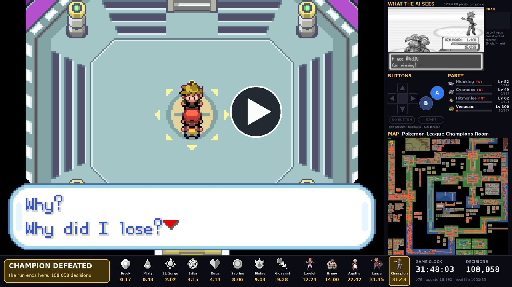

# PokemonFireRedRL: a screen-only PPO agent that beats Pokémon FireRed

This repository trains a reinforcement-learning agent that plays Pokémon FireRed from the new-game bedroom to the
Champion. It sees only the screen. It contains exactly what the run **v76** used, so you can train your own v76 from
scratch:

- a **native FireRed simulator** (`fireredsim`): the [pret/pokefirered](https://github.com/pret/pokefirered) decompilation compiled
  for 32-bit x86 Linux, with no CPU emulation (the build downloads the decompilation from pret);
- the **training environment**: reward, action mask, life ends, rewinds and "relay" scopes;
- the **policy**: a small CNN over the screen, two minGRU layers, PPO;
- a **live map viewer** of the training.

[](https://youtu.be/WcQT1N3yma8)

**Video:** [the full run on YouTube](https://youtu.be/WcQT1N3yma8) (30 minutes). It is one unedited life of the final
checkpoint, from the bedroom to the Champion in 108,058 decisions. Each video frame is one decision, 60 per second.

| v76 (one RTX 4090 + Ryzen 9 7950X, 1,024 envs, ~85k env steps/s) | update | env steps | wall time |
|---|---|---|---|
| Boulder Badge (badge 1) | 143 | 75 M | 0.3 h |
| Cascade Badge (badge 2) | 194 | 0.10 G | 0.4 h |
| Rainbow Badge (badge 4) | 860 | 0.45 G | 1.7 h |
| Volcano Badge (badge 7) | 8,667 | 4.5 G | 15.0 h |
| Earth Badge (badge 8) | 9,367 | 4.9 G | 16.2 h |
| Elite Four, first wins (Lorelei, Bruno, Agatha, Lance) | 12,734-12,798 | 6.7 G | 21.8 h |
| **Champion first beaten** | **12,953** | **6.8 G** | **22.2 h** |

An env step is one decision. Each update is 512 steps × 1,024 envs = 524,288 env steps. The run was stopped at
update 16,990 (8.9 G steps, 29.5 h). An evaluation of that checkpoint covered 1,024 lives from the bedroom with no
rewinds, stopped after about 127k decisions. Of those lives, 34 % earned all eight badges and 0.4 % beat the Champion.

Training is not bit-for-bit reproducible: CUDA kernels and the asynchronous collector's timing vary from run to run.
A retrain therefore runs the same code and settings as v76 on its own trajectory, and its milestones will land at
different updates. It also runs faster: on the same machine, this repository collects 91-95k env steps/s over the
first 350 updates, against v76's 69-74k (PGO worker), so it reaches the same update sooner.

## How it works

**Simulator.** The game's own C code (scripts, battle engine, AI, RNG, menus) runs natively, linked so that every
RAM variable sits at its retail address. A thin platform layer (`platform/`) replaces the GBA hardware. One
`fireredsim-worker` process runs a pool of games, and Python drives the workers through shared memory. The
simulator was verified frame by frame against mGBA running the retail ROM in the project this repository was
extracted from:

- the early-game scenarios, 56,644 frames, 0 divergences;
- a full story run from the bedroom to the credits, 640,000 frames, 0 mismatches;
- 482 synthetic late-game configurations.

`game/NATIVE_CHANGES.md` lists every change to the decompilation. One documented deviation: the simulator has no
lag frames, as if the GBA CPU were infinitely fast. Its play is valid FireRed but not frame-identical to hardware
where the real console lags (warps, battle setup, saves). The simulator is built from the decompilation's sources,
which this repository does not contain: `tools/fetch_game.sh` downloads pret's files at a fixed commit and applies
`game/native/pokefirered.patch`, the simulator's changes to them.

**Environment** (`rl/pokerl/env.py`; its docstring is the full specification):

- **Steps** run from one decision point to the next. Each step plays 24 frames, then idles until the game waits
  for input again, up to 384 frames. A D-pad press toward a new direction is held long enough to turn and walk
  one tile.
- **Actions** are NOOP, A, B, START, UP, DOWN, LEFT and RIGHT. They are masked to the buttons the game currently
  reads, and A is masked on start-menu entries that never advance the game, on the save prompt and on RELEASE
  (`rl/pokerl/mask.py`).
- **Observation**: the screen as 80×120 gray (2×2 luma average), an 11×15 "trail" plane over the map tiles around
  the player (how recently each tile was walked on), and the previous action. Nothing else: the policy's inputs
  never include RAM; only the reward, the mask and the life ends read it.
- **Reward** (`rl/pokerl/reward.py`): read from game memory. It pays the first time something happens in a life:
  - story flags, trainers beaten, badges, Elite Four and Champion;
  - new tiles (a count bonus for tiles few earlier lives reached), new maps, story variables, key items;
  - party level gains, capped at the next gym leader's ace (×3 at Indigo Plateau);
  - HMs taught, puzzle objects, overworld interactions, menu skills, unique purchases and item uses.

  A small penalty applies when the whole party faints (whiteout).
- **Lives** start in the bedroom. A life ends:
  - after 2,048 steps without progress (stagnation);
  - at a length cap (327,680 steps; the first life of each env gets a staggered cap);
  - when the Champion is beaten;
  - when the life leaves its relay scope.
- **Rewind**: a stagnation end can instead restore one of the env's own recent snapshots, with the policy's memory
  and the reward's "already paid" state. Each life draws its budget uniformly from 0..3; the upper end rises by one
  per badge the life has held.
- **Relay scopes** (`rl/pokerl/relay/`): six game regions in story order (Vermilion, Celadon, Fuchsia, Saffron,
  Cinnabar, Viridian → Pokémon League). Each scope activates in turn: the previous one is cleared, its entry
  condition holds (badges or key items), and the life is in its home city. The active scope then confines the life:
  - D-pad presses that would leave the area are masked;
  - leaving it any other way (Fly, a whiteout) ends the life.

  Activating and clearing a scope pay 2 each.

**Policy** (`rl/pokerl/model.py`, about 2.7 M parameters):

- The CNN is tile-aligned, with no pooling; the trail plane joins at the third convolution.
- The core is two minGRU layers of 512 with residual connections, then policy and value heads.

**PPO** (`rl/pokerl/ppo.py`):

- 1,024 envs × 512 steps per update: one epoch of 64 minibatches.
- Settings: γ 0.997, λ 0.95, clip 0.2, entropy coefficient 0.03, value coefficient 0.25, learning rate 2.5e-4 with
  a 100-update warm-up.
- Rewards are scaled by the running std of the return.
- The minGRU runs as a parallel scan over the rollout.
- Rollout collection overlaps the update: three env groups, CUDA graphs and a second copy of the model for acting.

The reward and the mask are computed in C (`rl/pokerl/native/`, compiled on first use for the configured weights).

## Requirements

- **System:** Linux x86-64 that can run 32-bit binaries (developed on WSL2 Ubuntu 22.04). The worker uses futexes
  and `memfd_create`.
- **Build tools:** git (and network access for the first build), gcc/g++ with 32-bit multilib (GCC 11.4 used),
  make, CMake ≥ 3.20, Ninja, pkg-config, and the libpng and zlib development packages (for pret's graphics tools).
- **Python:** Python ≥ 3.9 with NumPy, PyTorch (CUDA; developed on 2.14) and TensorBoard (`requirements.txt`).
- **Hardware for the v76 settings:**
  - an NVIDIA GPU with 24 GB: the rollout store alone is 9.7 GiB, and the card ran at 18.8 GiB;
  - 16+ CPU cores: the 1,024 games run on all of them;
  - about 32 GB of RAM (v76 used about 27 GB).

  Fewer envs need less (see below).

On Ubuntu:

```bash
sudo apt install git build-essential gcc-multilib g++-multilib cmake ninja-build pkg-config libpng-dev zlib1g-dev python3-pip
pip install -r requirements.txt     # install the CUDA build of PyTorch that matches your driver
```

## Build

```bash
tools/build_worker.sh               # build/worker/fireredsim-worker; the first build compiles the whole game (minutes)
PGO=1 tools/build_worker.sh         # optional: + profile-guided optimisation (two builds and ~3 min of random play)
```

The first build runs `tools/fetch_game.sh`: it downloads pret/pokefirered at the commit in `game/UPSTREAM.txt` into
`game/` (about 55 MB) and applies `game/native/pokefirered.patch`. The v76 run used a PGO build, which only changes
speed. The build also generates the game's assets into `game/` (git-ignored) and checks the RAM layout against the
retail symbol table (886 of 907 variables at their retail address; the 21 others are documented in
`game/NATIVE_CHANGES.md`).

## Train

```bash
tools/train.sh v76_repro            # a fresh v76 in rl/runs/v76_repro (detached; log in rl/runs/v76_repro/train.out)
tensorboard --logdir rl/runs        # losses, SPS, reward terms, badges, events_ep/* milestones
kill -INT <pid>                     # stop: finishes the update and saves a checkpoint
tools/train.sh --resume v76_repro   # continue from the last checkpoint
```

`python3 -m pokerl.train --help` (with `PYTHONPATH=rl:python`) lists every flag. The defaults are v76, so any flag
you pass is a change from it, for example `--ent-coef 0.02` or `--level-reward 0.5`. Each run directory holds:

- `config.json`;
- `log.csv`, one row per update;
- `first_seen.csv`, the update at which any env first reached each milestone;
- `events.csv`;
- `tb/`;
- `ckpt_*.pt` every 50 updates (the last 3 kept) and `best.pt`.

**On a smaller machine**, scale down with `--num-envs 512 --minibatches 32` or `--num-envs 256 --minibatches 16`.
`--num-envs` must be a multiple of `--minibatches`, and keeping 8,192 samples per minibatch keeps v76's update
shape. This is no longer v76: fewer envs collect fewer steps per update.

## Watch

```bash
python3 tools/mapviz/build_world.py   # once: renders the world map from game/data (~45 s)
python3 tools/mapviz/serve.py         # open http://localhost:8780/
```

The map shows every env's player live, a dwell heatmap (**M**) and the run's tile-visit novelty from checkpoints
(**N**). `/party.html` shows every env's party, moves and badges, plus an on-request sample of battle and party
habits. The server reads the trainer's shared memory read-only, and only while a page is visible.
`tools/mapviz/README.md` has the details.

## Tests

```bash
export PYTHONPATH=rl:python FIREREDSIM_WORKER=$PWD/build/worker/fireredsim-worker
python3 -m pytest -q rl/tests                  # environment, reward, mask, relay, model, training smoke run (CPU)
python3 -m pytest -q python/tests              # the vec env and the workers (run apart from rl/tests)
cmake --build build && ctest --test-dir build  # simulator determinism: replay twice, snapshot / restore, interleaved envs
```

## Repository map

| Path | Contents |
|---|---|
| `game/` | the simulator's additions to pret/pokefirered: the native build (`Makefile.native`, `native/`), the patch to pret's files (`native/pokefirered.patch`, changes guarded by `PORTABLE` and listed in `NATIVE_CHANGES.md`) and the upstream commit (`UPSTREAM.txt`); `tools/fetch_game.sh` adds pret's files |
| `platform/` | the GBA hardware replacements: registers, BIOS, DMA, interrupts, sound, flash, frame driver |
| `sim/` | C++ host library: environments, stepping, snapshot / restore, input scripts |
| `obs/` | the observer: one `PnObs` record of game state per env and step (`obs/observation.h`), input-wait detection |
| `render/` | the PPU renderer for the screen observation (derived from mGBA, MPL-2.0) |
| `worker/` | `fireredsim-worker`: the env pool process and its shared-memory protocol (`worker/pn_ipc.h`) |
| `python/fireredsim/` | `PokeVecEnv`: batched games over the workers, start states, seeds |
| `rl/pokerl/` | environment, reward, mask, rewind, relay scopes, model, PPO, training CLI (`train.py`) |
| `rl/pokerl/native/` | the reward, mask and trail plane in C |
| `tools/` | `fetch_game.sh`, `build_worker.sh`, `train.sh`, `mapviz/`, `mirror/` (the memory layout's linker script), `gen_obs_dtype.py` |
| `docs/` | the thumbnail of the video linked above |
| `reference/` | the retail ROM's RAM symbol table (names, addresses, sizes) that the memory layout follows |

## Licence

This repository's own code is under the MIT licence (`LICENSE`). The exceptions are listed, with their notices, in
`THIRD_PARTY.md`:

- the [pret/pokefirered](https://github.com/pret/pokefirered) decompilation is not in this repository;
  `tools/fetch_game.sh` downloads it;
- `game/native/pokefirered.patch`, `platform/sound.c` and `platform/gcn_multiboot.c` are derived from the game's own
  code and are not covered by the MIT licence;
- `docs/v76_full_run.jpg` is a frame of the video and shows the game's graphics;
- `render/src/pn_ppu.*` and `platform/bios.c` are derived from [mGBA](https://mgba.io) and stay under the MPL-2.0;
- `platform/libc_port.c` follows three newlib string functions (Cygnus Solutions' notice);
- `tools/mapviz` is adapted from [PWhiddy/pokerl-map-viz](https://github.com/PWhiddy/pokerl-map-viz) and vendors
  PixiJS (both MIT).

Pokémon and Pokémon FireRed are trademarks of Nintendo, Creatures Inc. and GAME FREAK inc. This project is not
affiliated with or endorsed by them. It is meant for education and research.
